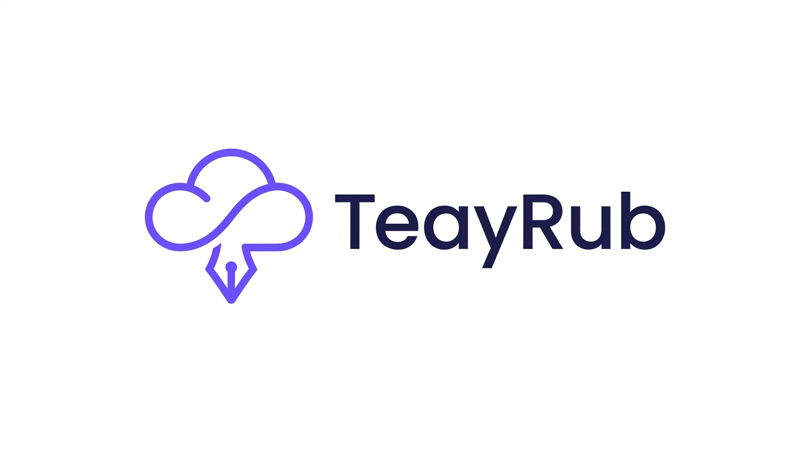

<p align="center">
  
</p>

# TeayRub

**Draw it. Guess it. Scale it.**

TeayRub is a real-time multiplayer draw-and-guess web game built with a notebook-and-marker aesthetic and deployed on AWS (`ap-southeast-1`) across two Availability Zones.

---

## Features

- **5-Character Room Codes**: Create a room or join friends instantly—no account required.
- **Real-Time Shared Canvas**: Smooth HTML5 drawing with normalized `0..1` coordinates (works on both phones and desktops) and ~40 ms stroke batching.
- **Fair Play & Live Scoring**: Server-authoritative word selection, progressive letter hints, time-based scoring, and automatic chat leak prevention.
- **Hall of Fame & Leaderboard**: Rounds with a correct guess are saved as PNGs directly to S3 via presigned `PUT` URLs.
- **Stateless & Resilient**: All game state lives in Redis; servers sync via Redis Pub/Sub and recover automatically from server or AZ failures.

---

## Architecture

- **Frontend**: Plain HTML5 / CSS3 / ES Modules (`web/`), zero build step, hosted on **S3 + CloudFront**.
- **Backend**: Stateless Node.js 20 (`Express` + `ws` + `ioredis`) on **ECS Fargate** across 2 AZs behind an **ALB**.
- **State & Pub/Sub**: **ElastiCache Redis (Multi-AZ)** with distributed timer locks and atomic Lua scripts.
- **Persistence**: **Amazon DynamoDB** (on-demand) for leaderboard, match history, word bank, and gallery metadata.
- **Infrastructure**: 100% **Terraform** (`infra/`).

See [docs/diagrams/architecture.md](docs/diagrams/architecture.md) for full architecture and VPC diagrams.

---

## Run Locally (Docker Compose)

Start the local multi-instance stack (`nginx` load balancer + 2 stateless Node.js servers + Redis):

```powershell
docker compose up --build
```

1. Open **two browser tabs** to `http://localhost:8080`.
2. Create a room in Tab 1 and join with the 5-character code in Tab 2.
3. Check the footer in each tab to see which server (`server1` / `server2`) you are connected to.

### Run the Automated Smoke Test

```powershell
cd loadtest
npm install
node smoke.js http://localhost:8080 http://localhost:8080
```

---

## Deploy to AWS (`ap-southeast-1`)

> **Cost Note**: Running the full AWS stack costs ~\$0.14/hr (~\$1.13 per 8-hour demo day). Always run `terraform destroy` when finished.

```powershell
# 1. Create ECR repository first
cd infra
terraform init
terraform apply -target=aws_ecr_repository.app

# 2. Build & push server image
..\scripts\deploy-server.sh

# 3. Provision full AWS stack
terraform apply

# 4. Deploy frontend & seed word bank
..\scripts\deploy-web.sh
cd ..\server && npm run seed-words
```

### Load Test & Failover Demo

```powershell
# 320 simulated players (40 rooms x 8 bots)
node loadtest/bots.js https://<your-cloudfront-domain> 40 8

# Simulate AZ + Redis failover
./scripts/simulate-az-failure.sh
```

### Teardown (Stop All Charges)

```powershell
cd infra
terraform destroy
```

